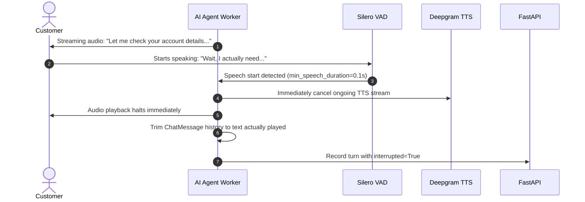

# VoiceOps Architecture & System Design

## 1. High-Level System Architecture

```mermaid
flowchart TB
    subgraph ClientLayer ["Client Presentation (Next.js 14 App Router)"]
        CustomerUI["Customer Call UI (/call/[id])\n- livekit-client WebRTC\n- Real-time Audio Stream\n- Live transcript display"]
        OperatorUI["Hidden Operator UI (/operator/[id])\n- Hidden observer token\n- Real-time Whisper input\n- Human Takeover button"]
        DashboardUI["Operations Dashboard (/dashboard)\n- 5-stage latency waterfall\n- Automated compliance audits\n- Historical session explorer"]
    end

    subgraph MediaPlane ["Media Plane (Self-Hosted LiveKit SFU)"]
        SFU["LiveKit Server v1.8 (Docker)\n- Port 7880: WS Signalling / SDP\n- Port 7881: TCP Media Fallback\n- Ports 50000-60000: UDP RTP Media\n- Port 3478: STUN/TURN Relay"]
        Room["Room: 'call-{call_id}'\n- Customer: publish audio, sub audio\n- Agent: publish audio, sub audio\n- Operator: hidden sub audio, data pub"]
    end

    subgraph WorkerPlane ["Voice AI Worker (Python LiveKit Agents)"]
        AgentServer["Agent Server Worker Pool\n- Explicit Dispatch via Backend\n- Dynamic Configuration Loading"]
        VAD["Silero VAD\n(Prewarmed per process)"]
        STT["Deepgram Nova-3 STT\n(Streaming WebSocket)"]
        LLM["Groq LLaMA 3.3 70B\n(~95ms TTFT via OpenAI SDK)"]
        TTS["Deepgram Aura-2 TTS\n(Low-latency audio streaming)"]
        TurnDetector["LiveKit Multilingual Turn Detector\n(Semantic EOT evaluation)"]
        SupervisorHandler["Private Whisper & Takeover Handler\n- Whisper -> System prompt injection\n- Takeover -> Audio muting"]
    end

    subgraph ControlPlane ["Control Plane (FastAPI Backend)"]
        API["FastAPI REST & Webhooks\n- POST /agents, GET /agents/{id}\n- POST /calls (Room, Token, Dispatch)\n- POST /internal/calls/... (Telemetry)"]
        DB[(SQLite / Postgres DB)\n- Agents, Calls, Turns\n- Whispers, Latency Metrics\n- Compliance Audits]
        Compliance["Compliance Audit Engine\n- Deterministic: Recording < 30s\n- Deterministic: Supervisor secrecy\n- LLM: No refund promise (Structured)"]
    end

    CustomerUI <-->|WebRTC Audio + Data| SFU
    OperatorUI <-->|Hidden WebRTC Audio + Data| SFU
    SFU <--> Room
    Room <-->|WebRTC Audio + Data| AgentServer

    AgentServer --> VAD --> STT --> TurnDetector --> LLM --> TTS --> AgentServer
    SupervisorHandler <--> AgentServer

    CustomerUI -->|REST| API
    OperatorUI -->|REST| API
    DashboardUI -->|REST| API
    AgentServer -->|Telemetry / Internal REST| API
    API --> DB
    API --> Compliance
```

---

## 2. WebRTC Media Flow & Signal Flow

1. **Signalling (Port 7880 TCP):**
   - Client fetches participant JWT from FastAPI (`POST /calls` or `POST /calls/{id}/operator-token`).
   - Client opens WebSocket to LiveKit SFU on `ws://<host>:7880`.
   - Client and Server exchange SDP (Session Description Protocol) offer/answer to negotiate codecs (Opus at 48kHz).

2. **ICE Candidate Negotiation:**
   - Client gathers `host` (LAN IP), `srflx` (public IP discovered via STUN on port 3478 UDP), and `relay` (TURN relay on port 3478 UDP if symmetric NAT or corporate firewall restricts direct UDP).
   - Once candidate pair is selected, DTLS handshake establishes encryption keys for SRTP.

3. **Media Transport (Ports 50000–60000 UDP):**
   - Media packets flow over UDP using SRTP (Secure Real-time Transport Protocol).
   - Why UDP: Audio cannot tolerate head-of-line blocking (TCP retransmission delay). If a packet is lost, Opus Packet Loss Concealment (PLC) conceals the drop.

4. **SFU Selective Forwarding:**
   - LiveKit forwards RTP packets without transcoding or decoding/mixing.
   - Saves CPU (1 core can handle hundreds of audio streams) and minimizes latency (<5ms server processing delay).

---

## 3. Real-Time Interruption (Barge-in) Architecture



- When the customer interrupts, the agent does **NOT** retain what the LLM hallucinated or had queued up.
- The LiveKit `AgentSession` tracks the synchronized playback timestamp and trims `ChatMessage.content` strictly to the words actually played before cancellation.
- This ensures downstream LLM turns are never confused by sentences the user never heard.

---

## 4. Operator Guidance (Whisper & Takeover) Architecture

### A. Private Whisper
1. Operator types instruction: `"Offer 10% discount on renewal"`
2. Operator UI publishes data packet on topic `"whisper"`:
   ```json
   {
     "type": "whisper",
     "text": "Offer 10% discount on renewal",
     "sent_at": 1729600000.123
   }
   ```
3. Agent Worker receives packet via `room.on("data_received")`.
4. Agent injects private instruction into chat history:
   ```
   [PRIVATE INSTRUCTION from supervisor - incorporate naturally, NEVER mention operator/supervisor]: Offer 10% discount on renewal
   ```
5. Agent's output guard enforces that forbidden words (`operator`, `supervisor`, `whisper`) are filtered out.
6. Customer hears only the natural response: *"I'd be glad to apply a 10% courtesy discount to your next monthly billing cycle."*

### B. Human Takeover (Stretch Goal)
1. Operator clicks **"Take Over"**:
   - Sends packet `{"action": "start"}` on topic `"takeover"`.
   - Agent worker invokes `session.output.set_audio_enabled(False)` — muting agent audio output and halting response generation.
   - Operator UI enables local microphone: `room.localParticipant.setMicrophoneEnabled(true)`.
   - Operator speaks directly to customer.
2. Operator clicks **"Hand Back"**:
   - Operator UI mutes microphone: `room.localParticipant.setMicrophoneEnabled(false)`.
   - Sends packet `{"action": "stop"}` on topic `"takeover"`.
   - Agent worker invokes `session.output.set_audio_enabled(True)` — resuming automated conversation.
